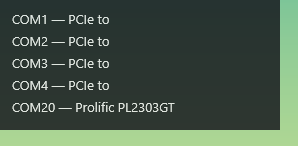

# COM HUD



Легкий и незаметный виджет для Windows, который отображает список активных COM-портов. 

## Особенности
- **Незаметность**: виджет скрыт и не мешает работе.
- **Горячий угол**: чтобы вызвать виджет, наведите курсор мыши в левый верхний угол экрана (в зону 10x10 пикселей).
- **Прозрачность для кликов**: окно не перехватывает клики мыши. Вы можете спокойно работать с приложениями под виджетом.
- **Актуальность**: список портов обновляется автоматически, названия берутся из диспетчера устройств (первые два слова).
- **Сортировка**: порты отсортированы по возрастанию номера (COM1, COM2, COM10...).

## ⚠️ Системные требования
Программа работает **исключительно на операционной системе Windows** (Windows 10 и Windows 11). 
Это связано с использованием нативных Win32 API (`SetupDiGetClassDevsW`, DirectComposition, `WS_EX_TRANSPARENT`), которые отсутствуют в Linux и macOS. На других ОС проект не соберется и не запустится.

## Установка и использование
1. Скачайте последнюю версию `com-hud.exe` из раздела **Releases** (Сборки).
2. Запустите файл. Никаких установок не требуется.
3. Наведите курсор в левый верхний угол экрана, чтобы увидеть список портов.
4. Отведите курсор, чтобы виджет снова спрятался.

## 🚀 Автозагрузка
Чтобы виджет запускался автоматически при старте системы и всегда был под рукой:

1. Нажмите `Win + R`, введите `shell:startup` и нажмите Enter. Откроется папка автозагрузки.
2. Скопируйте или переместите файл `com-hud.exe` в эту папку.
3. Готово. Теперь программа будет запускаться вместе с Windows в фоновом режиме.

*(Если вы переместили файл, убедитесь, что не удалили его из папки автозагрузки).*

## Сборка из исходников
Для сборки вам понадобится установленный [Rust](https://rustup.rs/).

```bash
# Клонируйте репозиторий
git clone https://github.com/ilushacode/com-hud.git
cd com-hud

# Соберите релизную версию
cargo build --release
```

Готовый исполняемый файл будет находиться в `target/release/com-hud.exe`.

## Лицензия
MIT